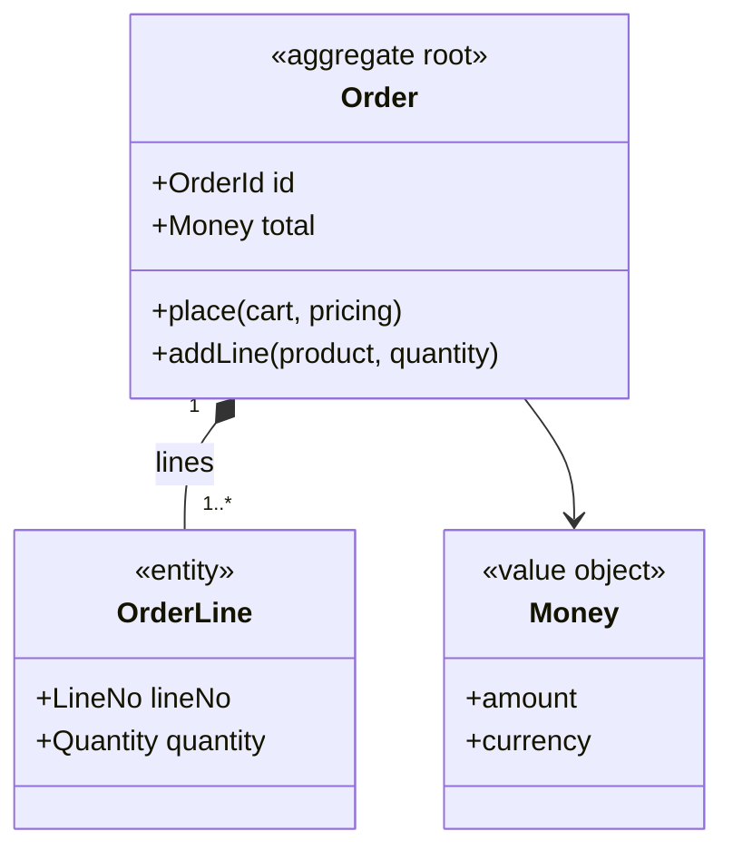

# Per-aggregate document — structure

Read by `design-aggregate` Stage 6 and auto-mode step 5 before writing
`reports/03_design/aggregates/aggregate-{aggregate}.md`. The body starts at `##` — the frontmatter
`title` is the document's H1 (`rules/output-conventions.md` § Document Structure). Document content
is in the configured output language; frontmatter keys and every identifier stay English.

```markdown
---
title: "Aggregate: {Aggregate}"
schema_version: 1
phase: "Phase 3: Design"
skill: design-aggregate
generated_at: "ISO8601"
aggregate: "{Aggregate}"
mode: "interactive|auto"
input_files:
  - reports/03_design/bounded-contexts-redesign.md
  - reports/01_analysis/ubiquitous-language.md
---

## Scope

[Which bounded context, what this aggregate is the unit of, and the candidates considered and
deliberately not made aggregates — with what they are instead.]

## Boundary

| Member | Kind | Identity / Validation | Notes |
|--------|------|-----------------------|-------|
| Order | root | OrderId | held by Shipment, Invoice |
| OrderLine | entity | LineNo, local to Order | never referenced from outside |
| Money | value object | amount >= 0, ISO 4217 currency | |
| customerId | reference → Customer | | ID only; name snapshot copied at `place` |

## Invariants

| ID | Invariant | Violated by | Enforced |
|----|-----------|-------------|----------|
| INV-1 | total equals the sum of line totals | addLine, removeLine | in the root, inside the command's transaction |

### Examples

| Invariant | Kind | Given | When | Then |
|-----------|------|-------|------|------|
| INV-1 | positive | two lines of 10 EUR | addLine(5 EUR) | total 25 EUR; OrderLineAdded |
| INV-1 | negative | submitted order | addLine(5 EUR) | rejected: order-not-editable |

## Commands and Events

| Command | Creation | Actor | Guard | Preserves | Emits | Consistency |
|---------|----------|-------|-------|-----------|-------|-------------|
| place | yes (factory: cart, pricing, customer) | Customer | cart has a line | INV-1 | OrderPlaced | local |
| addLine | | Customer | status is Draft | INV-1 | OrderLineAdded | local |

[A command that writes a second aggregate in the same transaction: its `also_writes`, the owner,
which §4 case it is, and the reconciliation for when the two disagree.]

[Then: every `distributed` / `saga` command with the aggregate that owns the transaction and the
compensation, and the events' payloads.]

## Specifications

| Specification | Predicate | Used by |
|---------------|-----------|---------|
| CanBeShipped | status is Approved and every line is allocated | ship, shippable-orders query |

## Repository

[Lookups, whether the whole aggregate is loaded, the read consistency, the OCC scope.]

## Diagram



## Lifecycle

[Whether the root has a lifecycle worth a machine and why (@rules/state-modeling.md §1). The
`STM-` itself is written back here and into the manifest's `state_machine` by
`design-state-machine`, which runs after this skill.]

## Open Items

[Failed well-formedness checks, defaulted consistency classes, and TBDs carrying their `OQ-` IDs.]
```
